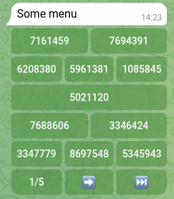
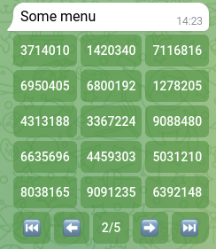
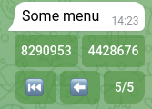

# aiogram-inline-paginations

## Description

A simple library for aiogram that allows you to easily do pagination for any Inline keyboards.

Install for pip:

```shell
pip install aiogram-inline-paginations
```

Install for poetry:

```shell
poetry add aiogram-inline-paginations
```

## Create paginations object

```python
from aiogram_inline_paginations.paginator import Paginator
from aiogram import types

kb = types.InlineKeyboardMarkup()
paginator = Paginator(data=kb, size=5)
```

### Params

**data**: Any ready-to-use keyboard InlineKeyboardMarkup or any iterable object with InlineKeyboardButton.

**size**: The number of rows of buttons on one page, excluding the navigation bar.

### Return

A paginator object that, when called, returns a ready-made keyboard with pagination.

## Get data for registrations handler paginator

```python
from aiogram_inline_paginations.paginator import Paginator
from aiogram import types

kb = types.InlineKeyboardMarkup()
paginator = Paginator(data=kb, size=5)


@dp.message()
async def some_func(message: types.Message):
    await message.answer(
        text='Some menu',
        reply_markup=paginator()
    )
```

### Return paginator_handler()

Data for registrations paginator.

## Example

```python
import asyncio
import random

from aiogram import Bot, Dispatcher, types
from aiogram.filters import CommandStart
from aiogram.fsm.storage.memory import MemoryStorage
from aiogram.utils.keyboard import InlineKeyboardBuilder

from aiogram_inline_paginations.paginator import Paginator

token = 'your token'

storage = MemoryStorage()
bot = Bot(token=token)
dp = Dispatcher(storage=storage)


@dp.message(CommandStart())
async def start(message: types.Message):
    await message.answer('Hello text')

    kb = InlineKeyboardBuilder()  # some keyboard

    '''To demonstrate, I will add more than 50 buttons to the keyboard and divide them into 5 lines per page'''
    for i in range(57):
        kb.row(
            types.InlineKeyboardButton(
                text=str(random.randint(1000000, 10000000)),
                callback_data='pass'
            )
        )

    paginator = Paginator(data=kb.as_markup(), size=5, dp=dp)

    await message.answer(
        text='Some menu',
        reply_markup=paginator()
    )


if __name__ == '__main__':
    async def main():
        await dp.start_polling(bot)

    asyncio.run(main())

```

## Check box paginations exemple

```python
import asyncio
import random

from aiogram import Bot, Dispatcher, types
from aiogram.filters import CommandStart, Text
from aiogram.fsm.context import FSMContext
from aiogram.fsm.storage.memory import MemoryStorage

from aiogram_inline_paginations.paginator import CheckBoxPaginator

token = 'your token'

storage = MemoryStorage()
bot = Bot(token=token)
dp = Dispatcher(storage=storage)


@dp.message(CommandStart())
async def start(message: types.Message, state: FSMContext):
    await message.answer('Hello text')

    kb = types.InlineKeyboardMarkup()  # some keyboard
    kb.add(
        *[
            types.InlineKeyboardButton(
                text=str(random.randint(1000000, 10000000)),
                callback_data=f'pass_{str(random.randint(1000000, 10000000))}'
            ) for i in range(2)
        ]
    )
    kb.add(
        *[
            types.InlineKeyboardButton(
                text=str(random.randint(1000000, 10000000)),
                callback_data=f'pass_{str(random.randint(1000000, 10000000))}'
            ) for i in range(3)
        ]
    )
    kb.add(
        types.InlineKeyboardButton(
            text=str(random.randint(1000000, 10000000)),
            callback_data=f'pass_{str(random.randint(1000000, 10000000))}'
        )
    )
    kb.add(
        *[
            types.InlineKeyboardButton(
                text=str(random.randint(1000000, 10000000)),
                callback_data=f'pass_{str(random.randint(1000000, 10000000))}'
            ) for i in range(2)
        ]
    )
    kb.add(
        *[
            types.InlineKeyboardButton(
                text=str(random.randint(1000000, 10000000)),
                callback_data=f'pass_{str(random.randint(1000000, 10000000))}'
            ) for i in range(50)
        ]
    )
    paginator = CheckBoxPaginator(
        data=kb,
        size=5,
        callback_startswith='page_',
        callback_startswith_button='pass_',
        confirm_text='Approve',
        dp=dp
    )
    await message.answer(
        text='Some menu',
        reply_markup=paginator()
    )


@dp.callback_query(Text(startswith='Approve', endswith='confirm'))
async def approve(call: types.CallbackQuery, state: FSMContext):
    data = await state.get_data()
    selected = data.get('page_selected', None)
    if selected:
        await call.answer(
            text='Your selected:\n' + '\n'.join(selected)
        )
    else:
        await call.answer(text='Nothing selected')


if __name__ == '__main__':
    async def main():
        await dp.start_polling(bot)

    asyncio.run(main())
```

confirim callback:

```python
f"{confirm_text}confirm"
```

selected data:

```python
data = await state.get_data()
selected = data.get(f'{startswith}selected', None)
```

## Screenshots

First page:



Second page:



Last page:



*The order of entries is not lost.*

## License MIT